# MCP Newsletter Studio

<p align="center">
  <strong>The AI Dispatch — a local-first, MCP-native research, editorial, and email-production system for keeping up with AI without drowning in it.</strong>
</p>

<p align="center">
  
  
  
  
  
  <a href="LICENSE"></a>
</p>

## What this project is

**MCP Newsletter Studio** is a local-first application that turns a week of fast-moving AI developments into a researched, source-linked, professionally designed newsletter. It combines the user's own editorial memory from Google Drive, Gmail, and Calendar with live evidence from web search, arXiv, GitHub, Product Hunt, and X; then it writes, designs, validates, saves, and presents the complete edition for human review.

### The need

AI evolves too quickly for a person to track reliably through manual browsing alone. New models, research papers, open-source repositories, developer tools, product launches, and technical discussions appear every day, while the context needed to judge them is scattered across bookmarks, inbox feedback, performance notes, content ideas, calendars, and previous newsletters.

### The problem it solves

The project replaces that fragmented weekly routine with one repeatable pipeline: remember what the audience wants, decide what matters this week, collect current evidence, preserve every source, write a coherent nine-section edition, create a responsive email, and stop for editorial approval. It reduces information overload without turning publication into a black box—the research, prompts, stage files, model activity, validation results, and final outputs remain inspectable.

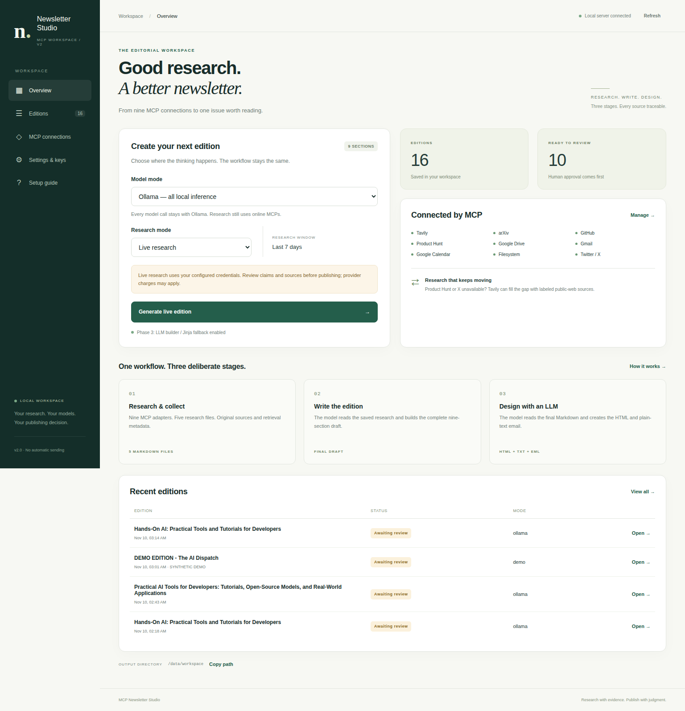

## Why I built this

Artificial intelligence no longer develops on a monthly release cycle. Important model releases, agent frameworks, research papers, developer tools, open-source repositories, product launches, and technical debates appear every day. A single week can contain enough announcements to fill dozens of browser tabs, feeds, saved posts, newsletters, and unread papers. The hard part is no longer finding AI information; it is continuously deciding what deserves attention, verifying where it came from, connecting it to previous interests, and turning it into something useful before the next wave arrives.

I built **MCP Newsletter Studio** to solve that problem for myself. Instead of manually checking the same sources each week, copying links into notes, remembering what readers liked, reconstructing an editorial structure, writing every section, and designing the final email, the application runs that entire workflow as one inspectable pipeline. It combines private editorial context from my own Google Drive, Gmail, and Calendar with current public evidence from web search, arXiv, GitHub, Product Hunt, and X. It then produces a source-linked nine-section newsletter, transforms the saved Markdown into a polished email, and pauses for human review rather than publishing automatically.

This is deliberately more than a prompt wrapped in a web page. It is a complete local application with an MCP host, remote and local MCP servers, OAuth flows, concurrent research, normalized source contracts, staged LLM generation, bounded retries, validation, resumable artifacts, a review dashboard, and exportable HTML/TXT/EML files. The project explores a practical question: **how can an AI system automate repetitive information work while keeping evidence, privacy, editorial judgment, and failure behavior visible?**

> The goal is not to read everything. The goal is to build a repeatable system that finds the right things, explains why they matter, and leaves the final publishing decision with a person.

---

## Product tour

The animation below records a complete **real live-research run** through the local dashboard—from starting the run, through live MCP collection and Ollama writing, to the generated newsletter and review tabs. The original run took several minutes; the waiting portions are accelerated while the start and final review remain readable.

<p align="center">
  <a href="docs/assets/video/newsletter-studio-live-run.mp4">
    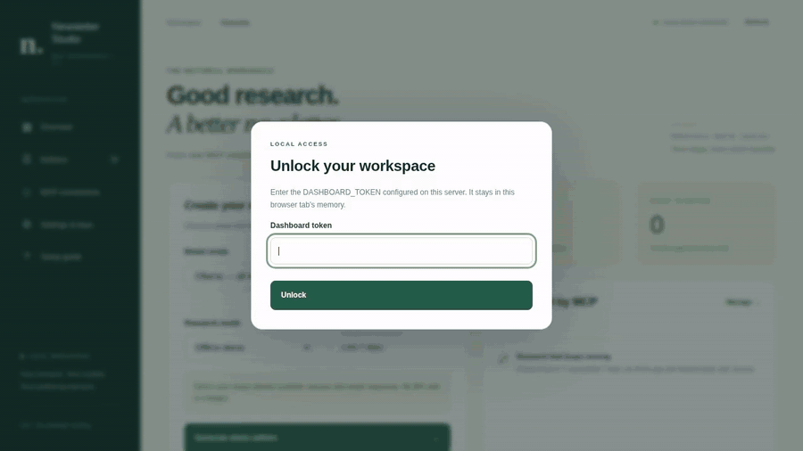
  </a>
</p>

<p align="center">
  <a href="docs/assets/video/newsletter-studio-live-run.mp4"><strong>Open the higher-resolution MP4 recording</strong></a>
</p>

The recorded run used the configured Google context, remote research MCPs, local Ollama model, real filesystem artifacts, and normal review workflow. It produced the populated draft and research galleries shown later in this README; it was not an offline fixture run.

---

## Project in five bullet points

- Built **MCP Newsletter Studio** to reduce the overwhelm of following fast-moving AI news by turning a week of scattered developments into one reviewable, source-linked newsletter.
- The system uses Google Drive for editorial ideas, performance history, and style guidance, Gmail for reader feedback, and Calendar for publication timing before public research begins.
- It collects current AI evidence through MCP servers for Tavily, arXiv, GitHub, Product Hunt, and X, then saves every research report and source record locally for provenance.
- It supports local Ollama as well as Groq, OpenAI, Claude, and Gemini to generate the newsletter, its Learning Corner, and a responsive email package from the saved Markdown.
- It validates sources, references, content preservation, and email-safe HTML, then gives the editor previews, downloadable artifacts, and final approval control instead of sending anything automatically.

---

## Recruiter quick scan

| Area | What is implemented |
|---|---|
| Product | A complete local web application for weekly AI-newsletter research, writing, design, review, and export |
| Architecture | Three durable stages with saved handoff artifacts: Research → Editorial Assembly → Email Design |
| MCP | Nine integrations using MCP initialization, tool discovery, JSON-RPC invocation, transport-specific authentication, and recorded provenance |
| Google context | Three custom read-only MCP servers for Drive, Gmail, and Calendar, connected through one local OAuth flow |
| Research | Concurrent Tavily, arXiv, GitHub, Product Hunt, and X collection with date filtering, deduplication, normalization, and labeled fallbacks |
| LLMs | Local Ollama models plus Groq, OpenAI, Claude, and Gemini; explicit mode selection and hybrid routing |
| Local-model engineering | Complex writing and email-design work is decomposed into small schema-bounded calls that are independently validated and assembled |
| Grounding | Models write prose, while source IDs and URLs are owned and attached by application code |
| Reliability | Bounded retries, timeouts, task deadlines, validation attempts, persistent run state, cancellation, and Phase 3 resume |
| Safety | Read-only Google scopes, restricted filesystem workspace, safe-HTML validation, sandboxed preview, no automatic sending, human approval |
| UI | FastAPI dashboard for runs, integrations, settings, editing, provenance, checks, activity, responsive preview, downloads, and approval |
| Outputs | Markdown, JSON, HTML, plain text, MIME EML, research reports, quality reports, manifests, and approval hashes |
| Verification | Unit, integration, API, MCP-contract, and browser-driven end-to-end tests; 140 tests passed in the documented local run |

---

## Table of contents

- [What the system produces](#what-the-system-produces)
- [The newsletter it creates](#the-newsletter-it-creates)
- [Project in five bullet points](#project-in-five-bullet-points)
- [System architecture](#system-architecture)
- [The complete end-to-end flow](#the-complete-end-to-end-flow)
- [Google integrations: the editorial intelligence layer](#google-integrations-the-editorial-intelligence-layer)
- [The MCP integration layer](#the-mcp-integration-layer)
- [Filesystem MCP: the durable backbone](#filesystem-mcp-the-durable-backbone)
- [Phase 1: context, planning, and research](#phase-1-context-planning-and-research)
- [Phase 2: source-grounded editorial assembly](#phase-2-source-grounded-editorial-assembly)
- [Learning Corner of the Week](#learning-corner-of-the-week)
- [Phase 3: LLM email design and deterministic mode](#phase-3-llm-email-design-and-deterministic-mode)
- [Why local models use smaller calls](#why-local-models-use-smaller-calls)
- [Model support and routing](#model-support-and-routing)
- [Dashboard and human workflow](#dashboard-and-human-workflow)
- [Artifacts and provenance](#artifacts-and-provenance)
- [Privacy and security](#privacy-and-security)
- [Quick start](#quick-start)
- [Google OAuth setup](#google-oauth-setup)
- [Live MCP setup](#live-mcp-setup)
- [Docker deployment](#docker-deployment)
- [CLI and scheduling](#cli-and-scheduling)
- [Using the MCP servers with Claude Desktop, Goose, and other hosts](#using-the-mcp-servers-with-claude-desktop-goose-and-other-hosts)
- [Verification and tests](#verification-and-tests)
- [Project structure](#project-structure)
- [TLDR](#tldr)

---

## What the system produces

One run starts with editorial memory and current public research and ends with a reviewable publication package:

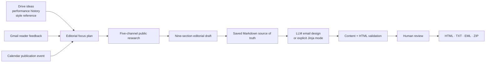

The application automates the repetitive parts of a weekly editorial workflow:

1. It retrieves the exact editorial documents configured in Google Drive.
2. It reads recent newsletter feedback from Gmail and the next relevant publication event from Calendar.
3. It turns those private signals into a compact focus plan for the edition.
4. It researches the public web, papers, repositories, products, and community discussion in parallel.
5. It normalizes every result into one source schema with stable IDs and retrieval metadata.
6. It generates a complete source-linked newsletter draft in nine consistent sections.
7. It creates a one-minute technical Learning Corner from the strongest current public research topic.
8. It saves Markdown as the boundary between editorial writing and email design.
9. It creates responsive HTML, plain text, and a multipart EML package.
10. It shows all evidence, checks, activity, and output in a human review workspace.

The application does **not** send the newsletter. Approval records who reviewed the exact artifact hashes; distribution remains an explicit action in the user's email platform.

---

## The newsletter it creates

Every edition follows a stable editorial contract while allowing the stories and teaching topic to change naturally with the research:

1. **Introduction** — frames the edition for the configured audience.
2. **Big Story of the Week** — one lead story grounded in a public web source.
3. **Quick Updates** — concise additional developments from distinct sources.
4. **Top Research Papers** — recent arXiv papers presented from their abstracts and metadata.
5. **Top GitHub Repositories** — recently pushed AI repositories meeting the configured star threshold.
6. **Learning Corner of the Week** — a one-minute explanation or mini-tutorial selected from current technical research.
7. **Top AI Products** — recent Product Hunt launches, or clearly labeled public-web launch evidence when fallback is used.
8. **Top Tweets of the Week / AI Community Highlights** — X evidence when available, otherwise a transparently renamed public-community section.
9. **Closing Notes** — a concise editorial conclusion.

The output contains source links directly beside the claims they support. GitHub star counts are labeled as total-star snapshots at retrieval time. arXiv content is identified as abstract-based. Fallback research is labeled as public-web evidence rather than authenticated platform data.

<details>
<summary><strong>View the complete generated newsletter</strong></summary>

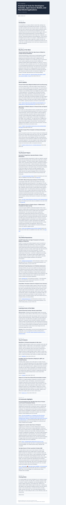

</details>

---

## System architecture

MCP Newsletter Studio is both an application and an MCP host. The FastAPI service owns the product workflow, state machine, validation, dashboard, and artifact lifecycle. The MCP client layer starts local stdio servers or connects to remote Streamable HTTP servers, discovers their tools, and exposes a uniform internal interface to the pipeline.

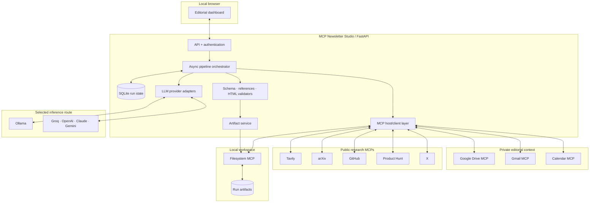

### Architectural principles

- **Saved stage boundaries:** research and Markdown are durable artifacts, not transient prompt variables.
- **Evidence before prose:** sources are collected, normalized, filtered, and saved before drafting begins.
- **Code owns references:** the LLM never gets permission to invent source IDs or URLs.
- **Private and public data are distinct:** private Google context shapes editorial planning; public research queries remain bounded and inspectable.
- **Provider choice is explicit:** the selected model route is visible in the UI and stored with the run.
- **Validation is part of generation:** a model response is not accepted merely because it is syntactically valid JSON.
- **Human publication control:** the system stops at reviewable artifacts.

---

## The complete end-to-end flow

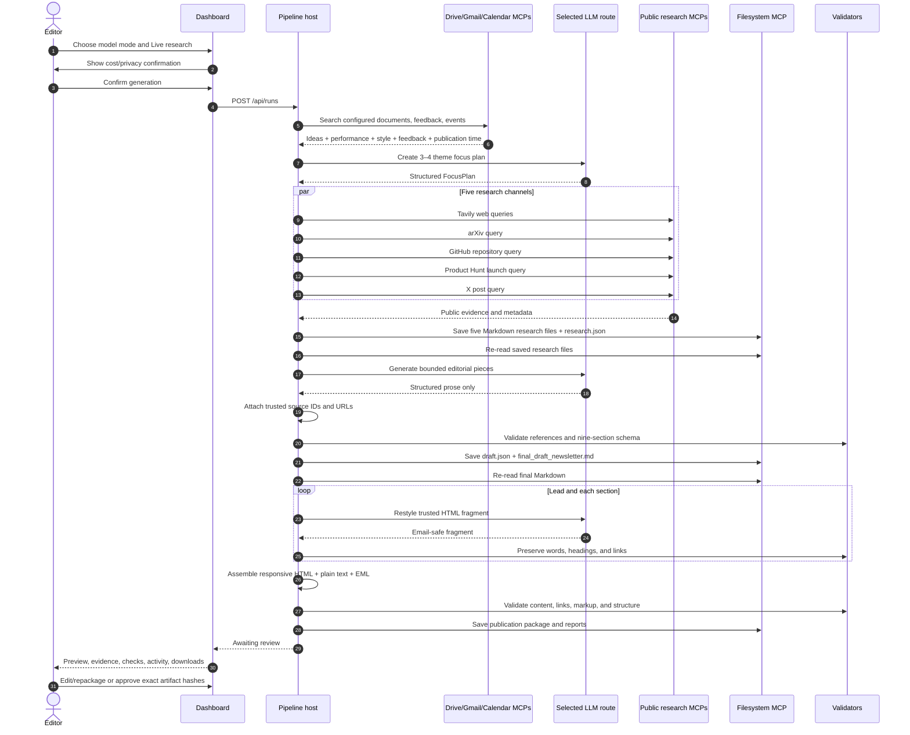

### Run state machine

The UI is backed by a real asynchronous run lifecycle. Navigation does not stop a run, and a completed stage leaves its artifacts behind.

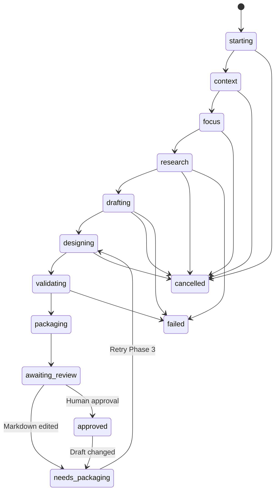

---

## Google integrations: the editorial intelligence layer

The Google integrations are not generic attachments added at the edge of the pipeline. They provide the **editorial memory and direction** that drives each issue before public research begins.

### The three Drive documents

By default, the Drive MCP searches for these exact names:

```text
AI Newsletter Performance Data
AI Newsletter Content Ideas
Sample Newsletter Template
```

Each document has a different job:

| Drive document | Role in the issue |
|---|---|
| **AI Newsletter Content Ideas** | Provides an editorial backlog: promising themes, questions worth researching, audience interests, tutorial ideas, and topic priorities. These are directions to investigate, not evidence that an event occurred. |
| **AI Newsletter Performance Data** | Provides memory from earlier editions: which topics and formats performed well, what should not be repeated too soon, and what the audience appears to value. The planner uses it as an editorial signal without inventing metrics. |
| **Sample Newsletter Template** | Provides style guidance: tone, pacing, section expectations, voice, and presentation preferences that should carry across issues while the actual stories remain current. |

The MCP reads a bounded amount of text from each matched file and passes it into the private focus-planning context. The focus model returns three or four themes plus editorial notes. That compact plan then guides the edition title, introduction, closing, story framing, and research emphasis. The files therefore influence the newsletter through an intentional editorial-planning boundary rather than being pasted indiscriminately into every downstream prompt.

### Gmail feedback

The Gmail MCP runs a configurable read-only query, for example:

```text
newer_than:30d {"newsletter feedback" "content suggestion"}
```

It retrieves a small set of recent messages, keeps the subject and a bounded body excerpt, and supplies them to the same private focus-planning step. Reader requests can therefore affect the next edition's priorities without being turned into public search terms. Attachments are not downloaded, messages are not modified, and no email is sent.

### Calendar timing

The Calendar MCP searches the configured calendar for an event matching `AI Newsletter` in the next 30 days. The earliest relevant event becomes the issue's publication timestamp and date. If no matching event is available, the local weekly schedule supplies the date. This lets editorial planning and the generated edition agree on when the issue is intended to publish.

### Google context flow

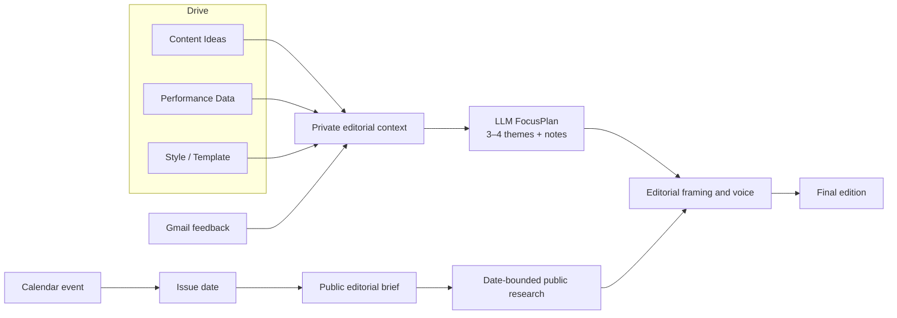

### Why custom Google MCP servers were built

Google now documents official remote Workspace MCP servers, but they are currently part of the **Google Workspace Developer Preview Program**. Preview onboarding requires program membership and a Google Workspace account and was not suitable for this project's personal-Gmail workflow. Instead of bypassing MCP and scattering direct Google API calls through the pipeline, this project implements three focused local MCP servers on top of Google's stable Drive, Gmail, and Calendar REST APIs.

The result preserves the same architectural boundary:

- The main application remains an MCP host.
- Each Google service exposes named MCP tools through a stdio server.
- One browser-based OAuth consent grants only the four required read-only scopes.
- The refresh token stays local; subprocesses receive a current short-lived access token.
- Google tool calls are visible in the MCP audit alongside the remote servers.

The scopes are intentionally narrow:

```text
https://www.googleapis.com/auth/drive.readonly
https://www.googleapis.com/auth/gmail.readonly
https://www.googleapis.com/auth/calendar.calendarlist.readonly
https://www.googleapis.com/auth/calendar.events.readonly
```

Official reference: [Configure Google Workspace MCP servers](https://developers.google.com/workspace/guides/configure-mcp-servers) and [Google Workspace Developer Preview](https://developers.google.com/workspace/preview).

---

## The MCP integration layer

Every external tool boundary uses MCP. The host initializes each enabled server, negotiates capabilities, discovers available tools, invokes the configured operation, parses the result, and records an audit entry. Local stdio and remote Streamable HTTP servers are normalized behind the same client abstraction.

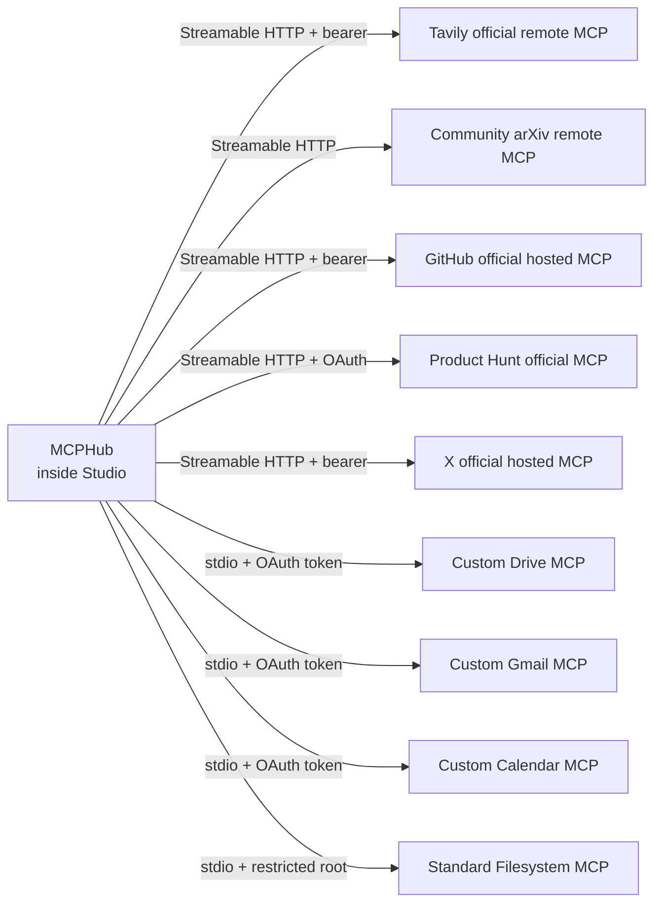

| Integration | Server type | Authentication | Primary operation | Purpose |
|---|---|---|---|---|
| **Tavily** | Official vendor-hosted remote MCP | API key / bearer | `tavily_search` | Current web research and labeled fallback searches |
| **arXiv** | Community remote MCP | Public | `arxiv_search_papers` | Recent papers from AI/ML/NLP categories |
| **GitHub** | Official GitHub-hosted MCP | GitHub token | `search_repositories` | Recently active AI repositories with meaningful adoption |
| **Product Hunt** | Official vendor-hosted remote MCP | Browser OAuth | `search_launches` | Current AI product launches and profiles |
| **X** | Official vendor-hosted remote MCP | App-only bearer | `search_posts_all` | Recent English AI posts, excluding retweets |
| **Google Drive** | Project-built local stdio MCP | Read-only Google OAuth | `search_files`, `read_file_content` | Ideas, performance history, and style reference |
| **Gmail** | Project-built local stdio MCP | Read-only Google OAuth | `search_feedback` | Recent reader feedback and content suggestions |
| **Google Calendar** | Project-built local stdio MCP | Read-only Google OAuth | `upcoming_events` | Publication date and editorial timing |
| **Filesystem** | Standard MCP filesystem server | Restricted local path | `read_text_file`, `write_file` | Durable stage handoffs and run artifacts |

Vendor references: [Tavily MCP](https://docs.tavily.com/documentation/mcp), [GitHub MCP](https://docs.github.com/en/copilot/how-tos/copilot-in-your-ide/copilot-for-common-tasks/use-the-github-mcp-server), [Product Hunt MCP](https://www.producthunt.com/mcp/install), and [X MCP](https://docs.x.com/tools/mcp).

### Public fallback behavior

Product Hunt and X are optional services. If either is disabled, unconfigured, unavailable, or returns no qualifying record, the pipeline can ask the Tavily MCP for one additional channel-specific public search. This is not a generic “latest AI” query:

- Product fallback looks for recent AI launch announcements and official product pages.
- Community fallback targets public X/Twitter pages, Hugging Face discussions, and Hacker News evidence relevant to the configured AI topics.
- Returned records keep their original URLs and publication dates when available.
- The source metadata records `tavily_fallback` and the UI displays a notice.
- The newsletter changes the social heading to **AI Community Highlights** when the evidence is not authenticated X data.

No protected-content scraping is used, and a fallback excerpt is never presented as a verified platform ranking.

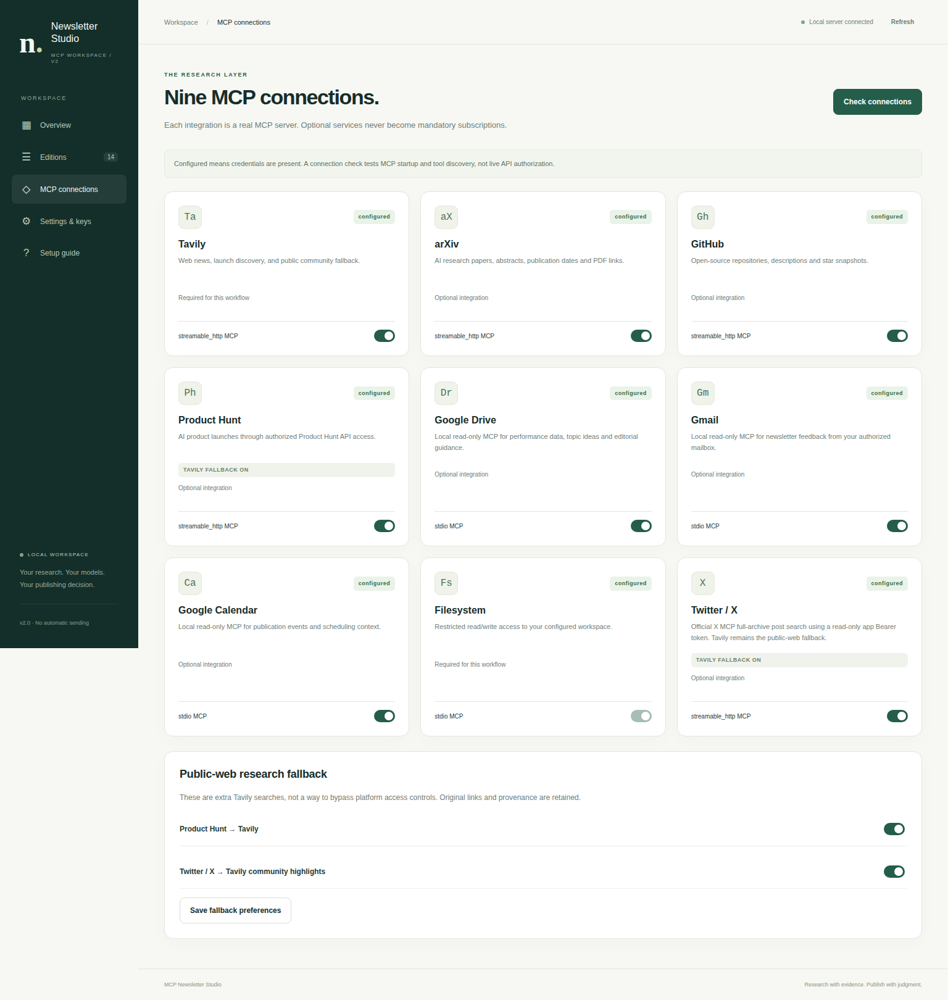

---

## Filesystem MCP: the durable backbone

The Filesystem MCP is the persistence boundary that connects every phase. It is not used merely to download the finished email: the pipeline uses it to create the run directory, save each individual research report, save normalized summaries and planning artifacts, re-read the exact inputs at stage boundaries, and write the complete publication package.

The server is the standard `@modelcontextprotocol/server-filesystem` package launched over stdio with one permitted root: the configured newsletter workspace. The Studio discovers and invokes its `create_directory`, `write_file`, and `read_text_file` tools through the same MCP client layer used for remote research services.

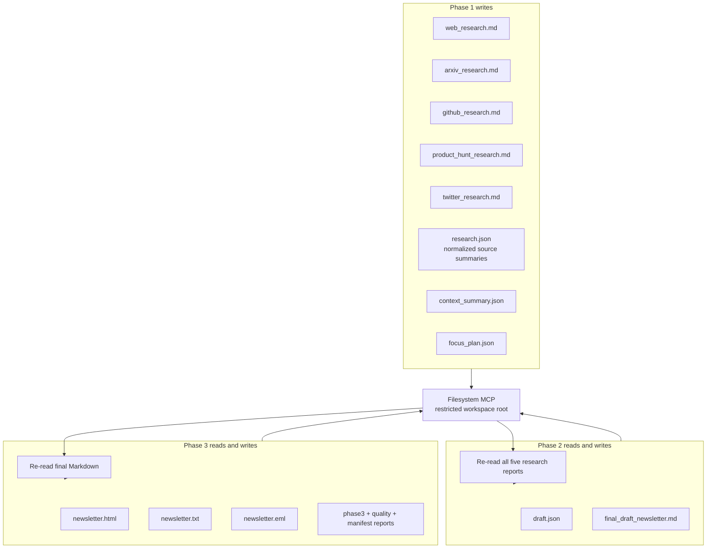

### What it saves at each boundary

| Boundary | Filesystem MCP responsibility |
|---|---|
| Research collection | Write one readable Markdown report for each of the five channels, even when an optional channel has no evidence and must contain an availability notice |
| Research normalization | Write `research.json` with the combined normalized sources, channel status, retrieval route, fallback markers, and excluded records |
| Editorial context | Write `context_summary.json` and `focus_plan.json` so the inputs and chosen direction of the issue remain inspectable |
| Drafting input | Re-read all five saved research reports before the writing model is called |
| Drafting output | Write both the structured `draft.json` and human-editable `final_draft_newsletter.md` |
| Design input | Re-read the saved final Markdown rather than relying on an in-memory draft object |
| Publication output | Write the final `newsletter.html`, `newsletter.txt`, and multipart `newsletter.eml` |
| Audit and review | Write Phase 3 details, validation results, model/MCP audit, hashes, warnings, and approval metadata |

This design makes the filesystem part of the protocol architecture. A research report can be opened independently, a failed design can resume from saved Markdown without repeating research, and a manual Markdown edit can invalidate and regenerate only the downstream package.

---

## Phase 1: context, planning, and research

Phase 1 has three distinct responsibilities: understand the publication, decide what deserves attention, and collect evidence.

### 1. Context collection

The host starts all enabled MCP connections and checks required services. It then:

- searches Drive for the three configured editorial documents;
- reads each unique match with a bounded character limit;
- searches Gmail for up to five relevant feedback messages;
- checks Calendar for the next publication event;
- records which files and messages were actually found in `context_summary.json`.

### 2. Focus planning

The focus call receives the audience, issue date, research window, configured topics, Drive documents, and Gmail feedback. It must return a small `FocusPlan` schema:

```json
{
  "themes": ["theme one", "theme two", "theme three"],
  "editorial_notes": "Concise guidance for this issue"
}
```

This is where historical performance, saved ideas, style, and reader requests become editorial direction. The planner is instructed not to invent metrics or expose personal identifiers. The resulting plan is saved as `focus_plan.json` and is reused during writing.

### 3. Concurrent public research

Five public channels then run concurrently:

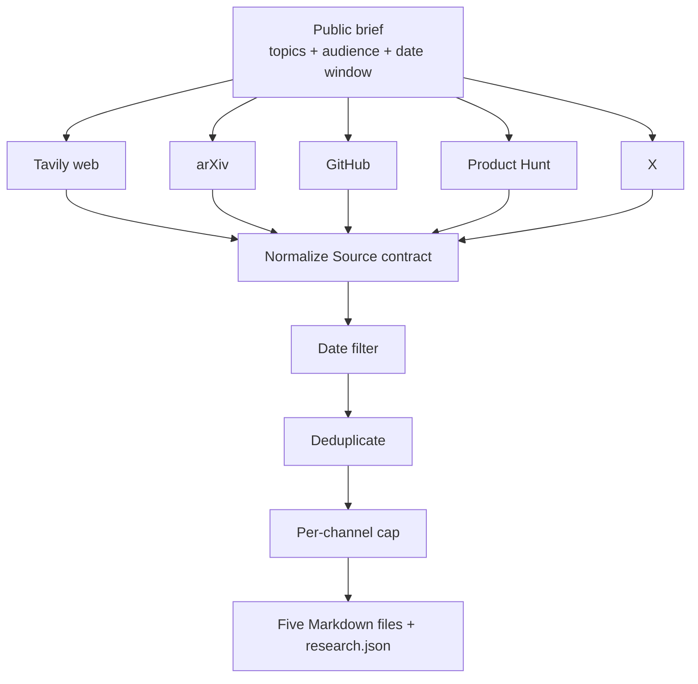

#### Tavily web research

The main web-research path creates multiple public, deterministic queries from the configured AI topics and research window. It seeks recent primary announcements, release notes, technical reports, and credible coverage. Search query text and retrieval method are stored in source metadata, so the final evidence can be inspected later.

#### arXiv research

The default query covers `cs.AI`, `cs.LG`, and `cs.CL`. Results are filtered to the issue window and rendered with paper links, PDF links when valid, publication dates, and an explicit note that the summary is based on the abstract.

#### GitHub research

The default repository query is:

```text
topic:artificial-intelligence archived:false fork:false stars:>100 pushed:>=<seven-days-ago>
```

The date term is computed at runtime. Results are sorted by total stars descending, filtered to non-archived non-forks, and limited to recently pushed repositories. The newsletter reports total stars at retrieval; if the same repository has been observed before, the state store can also report the change since that earlier observation.

#### Product Hunt research

The official Product Hunt MCP searches recent AI launches using Product Hunt OAuth. The system preserves launch URLs, product descriptions, dates, and provenance. If authenticated launch research is unavailable, the dedicated Tavily fallback is visibly labeled.

#### X research

The official hosted X MCP receives the configured recent-search query and uses an app-only bearer token for read-only access. Retweets are excluded by default. When X is disabled or unavailable, the public-community fallback creates an evidence-based highlights section rather than claiming it found the “top tweets.”

### The normalized source contract

Each provider returns a different payload. Before any source reaches a writer, the pipeline converts it into one schema containing:

- stable internal source ID;
- research channel;
- title and concise summary;
- canonical URL;
- retrieval timestamp;
- publication or last-push timestamp when available;
- provider-specific metadata such as GitHub stars or arXiv PDF URL;
- retrieval method and evidence level.

This normalization is what makes the later drafting stage provider-independent.

### Live research galleries

The following screenshots come from completed live runs and show the full six-card UI result set for each featured research channel. Every card exposes the fetched title, original link, evidence excerpt, internal source ID, source date, and retrieval route.

#### Web search — six fetched current-AI sources

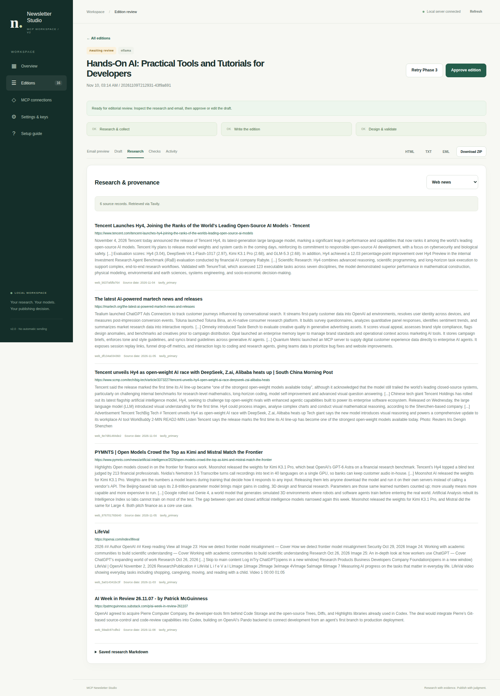

#### arXiv — six fetched research papers

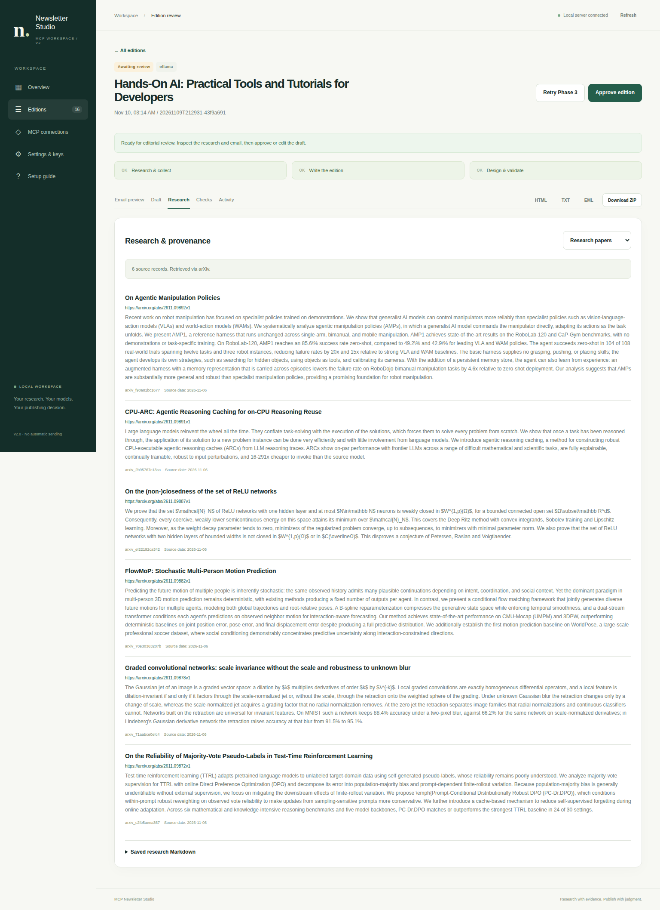

#### GitHub — six fetched AI repositories

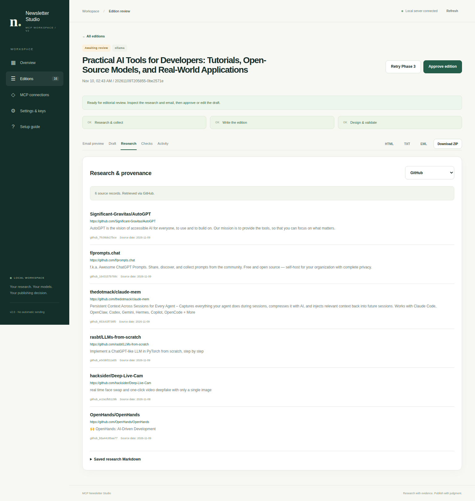

#### Product Hunt — six fetched AI products

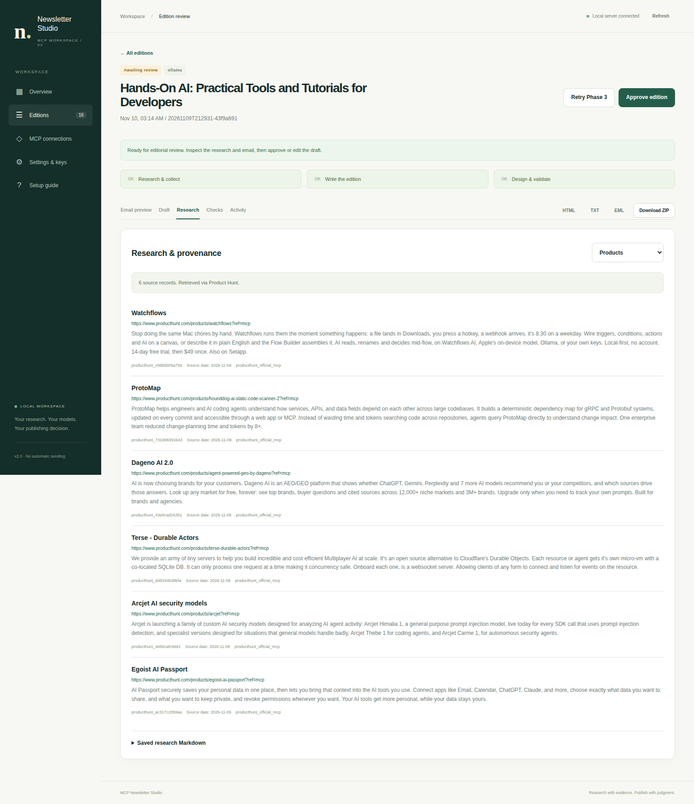

---

## Phase 2: source-grounded editorial assembly

Phase 2 begins by re-reading the five saved research Markdown files through the Filesystem MCP. That is a real stage boundary: the writer does not rely only on Python objects left in memory from Phase 1. The saved research is inspectable, resumable, and representative of what the editorial model is allowed to use.

### Why this phase is not one fragile mega-prompt

At the product level, Phase 2 is one editorial-writing phase. Internally, it uses bounded calls because a locally hosted 4B/8B model is much more reliable when each request has one clear responsibility and a small output schema.

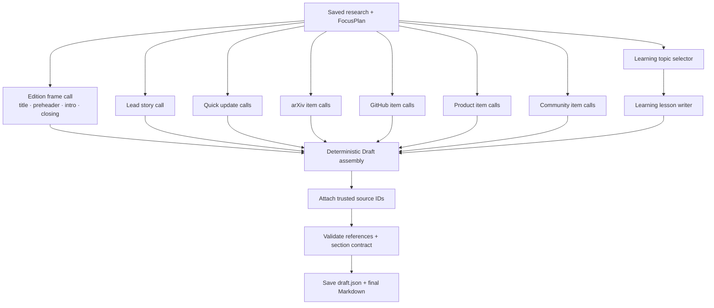

Each story call receives one source and returns only a title and body. It is explicitly told not to write URLs, source IDs, HTML, unsupported metrics, dates, or quotations. Application code then attaches the already-known source ID. This division of responsibility makes the model a prose generator while keeping citation authority in deterministic code.

### Reference validation

Before a draft can be saved:

- every source ID must exist in the research ledger;
- every source must belong to the correct channel;
- the same primary source cannot be silently reused as multiple editorial stories;
- a web source requires a lead story;
- enough web sources require the expected quick updates;
- an available arXiv/GitHub/Product Hunt/X channel must produce at least one corresponding item;
- tutorial references must also exist in the ledger.

The accepted result is stored twice:

- `draft.json` preserves the structured contract;
- `final_draft_newsletter.md` is the human-readable source of truth passed to Phase 3.

The editor can change that Markdown in the dashboard. Saving an edit marks previous HTML/TXT/EML outputs stale and requires Phase 3 to run again, ensuring the preview cannot drift away from the approved text.

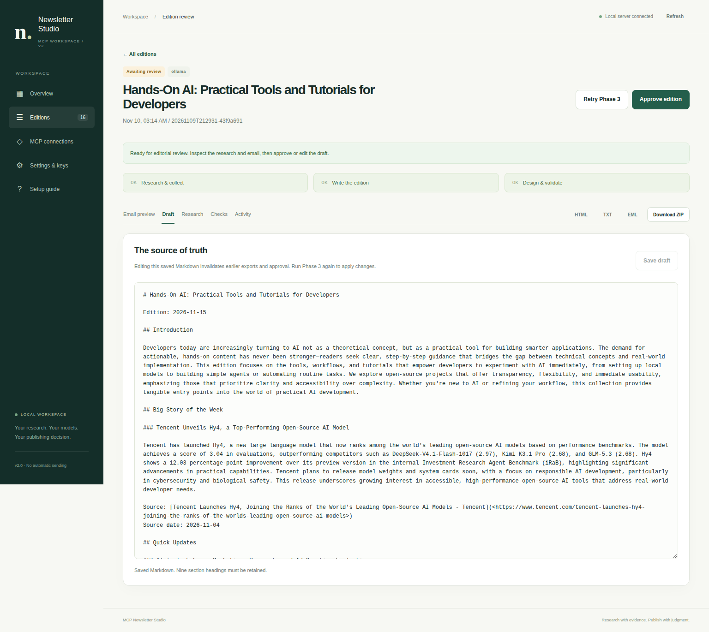

---

## Learning Corner of the Week

The Learning Corner is generated naturally from the current public research; it is not a hard-coded paragraph and it is not driven by a fixed assignment template.

The section is designed as a one-minute learning experience:

- one practical AI concept, mechanism, or engineering technique;
- a concise title and learning objective;
- either a coherent conceptual explanation or a 2–4 step mini-tutorial;
- optional code only when the selected evidence supports the syntax;
- one clear takeaway;
- a direct source link.

It uses exactly two focused LLM calls:

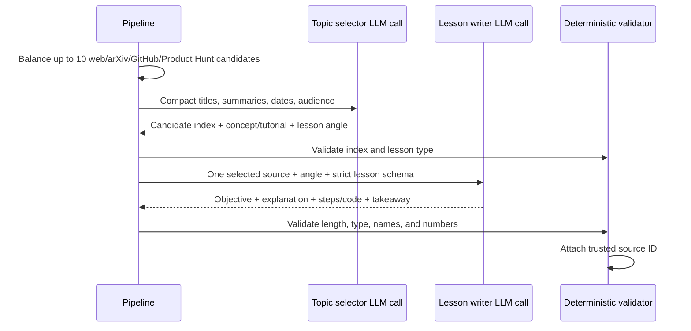

The selector prefers reusable technical understanding over product promotion or a recap of the news. The writer is limited to the selected evidence. Code validates the 55–240 word target, enforces that conceptual lessons contain no artificial steps, requires 2–4 steps for mini-tutorials, and rejects unsupported numbers or named technical terms. This gives the section variety without losing grounding.

---

## Phase 3: LLM email design and deterministic mode

Phase 3 is a genuine LLM design phase by default. It reads the saved `final_draft_newsletter.md` through the Filesystem MCP, converts the trusted Markdown into section-level HTML, and asks the selected model to restyle each bounded fragment as polished email-safe markup.

The model is not asked to rewrite the reporting. It must preserve every word, heading, and URL exactly while applying a constrained design system. The application then assembles the accepted fragments into one responsive, maximum-width email document and derives the plain-text alternative from the same Markdown.

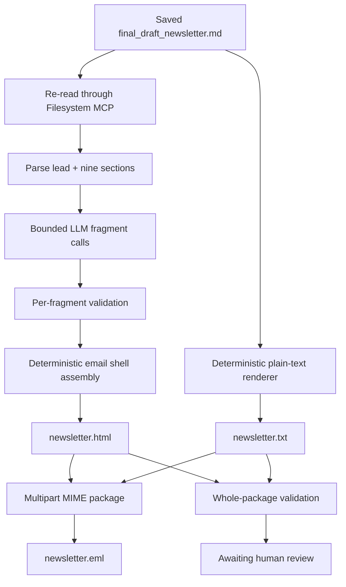

### Fragment validation

Each returned fragment is parsed and compared with its trusted source HTML. The validator requires:

- no full-document wrapper inside a fragment;
- only email-safe elements and approved attributes;
- only approved inline CSS properties;
- exactly the expected links, with no additions or substitutions;
- safe `http`/`https` URLs;
- `target="_blank"` plus `rel="noopener noreferrer"` on links;
- every source heading, paragraph, list item, and code block to remain present.

### Whole-package validation

After assembly, the final package is checked again for:

- all nine headings in order;
- preservation of source paragraphs and links;
- valid HTML structure;
- no script, form, iframe, external image, tracking pixel, hidden content, or event handler;
- safe CSS and links;
- a usable plain-text alternative;
- a SHA-256 record of the exact Markdown input.

### Explicit deterministic Jinja mode

Small local hardware sometimes benefits from spending model capacity on research and writing while rendering the final email deterministically. The project therefore includes an **explicit**, user-controlled Jinja mode.

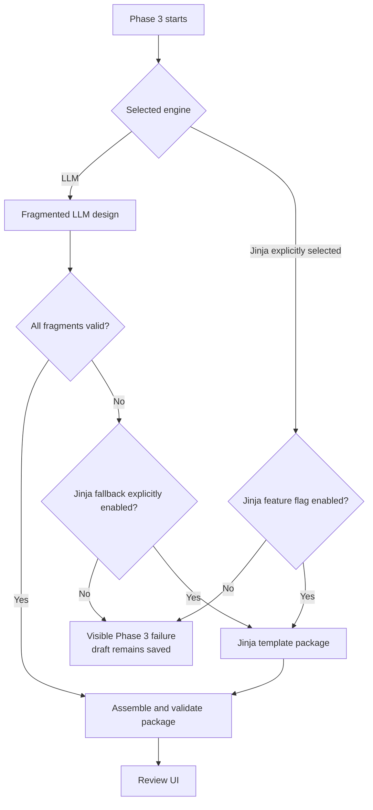

Jinja is not a hidden substitution. It must be enabled deliberately, the actual engine is written to `phase3_report.json`, and both engines consume the same saved Markdown and pass the package validators. The default distributed configuration is LLM Phase 3 with Jinja fallback disabled:

```yaml
phase3:
  mode: llm
  max_output_tokens: 16000
  validate_content_preservation: true

features:
  allow_jinja_fallback: false
```

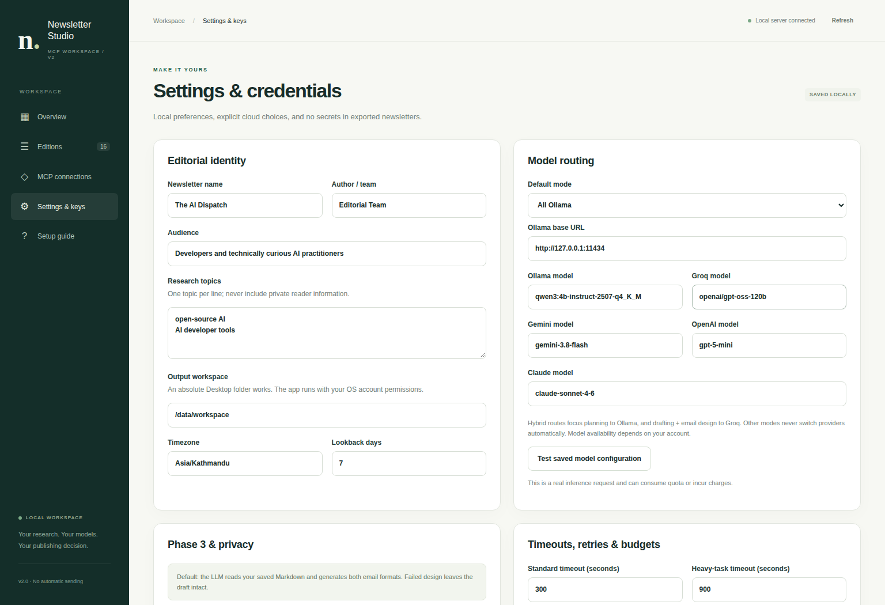

---

## Why local models use smaller calls

The workflow is organized around three meaningful phases, not dozens of disconnected agents. Within the two generative phases, however, local-model mode deliberately decomposes large outputs into smaller calls.

This design was introduced for concrete engineering reasons:

1. **Context discipline:** a 4B/8B model performs better when it sees only the evidence required for the current story or section.
2. **Schema reliability:** a flat two-field story schema is easier to satisfy than one very large nested newsletter schema.
3. **Output-length control:** local generations are less likely to truncate when each response has a bounded responsibility.
4. **Retry isolation:** an invalid GitHub item or email fragment can be regenerated without repeating every successful section.
5. **Citation safety:** the model never has to reproduce a large table of IDs and URLs across a long answer.
6. **VRAM practicality:** smaller prompts and responses make the workflow usable on consumer GPUs and laptops.
7. **Observable failures:** the audit log identifies the exact task that failed validation.
8. **Deterministic assembly:** code can guarantee final ordering, headings, source attachment, and email shell structure.

This does not reduce the newsletter to templated text. The LLM still performs topic selection, editorial framing, story writing, teaching, and visual styling. Decomposition changes the size of each contract, not the creative and analytical role of the model.

---

## Model support and routing

The system supports local inference with **Ollama** and cloud inference with **Groq, OpenAI, Claude, and Gemini**. The provider is selected explicitly in the dashboard or CLI; the pipeline does not silently switch providers.

| Mode | Planning and writing | Phase 3 design | Typical use |
|---|---|---|---|
| `ollama` | Local Ollama model | Local Ollama model | Maximum local control; consumer-GPU workflow |
| `groq` | Groq model | Groq model | Fast hosted inference |
| `hybrid` | Ollama for focus/small work; Groq for heavier writing | Groq | Keep private planning local while accelerating large generation |
| `openai` | OpenAI | OpenAI | Standard OpenAI API workflow |
| `claude` | Anthropic Claude | Anthropic Claude | Claude-based editorial and design workflow |
| `gemini` | Google Gemini | Google Gemini | Gemini-based editorial and design workflow |

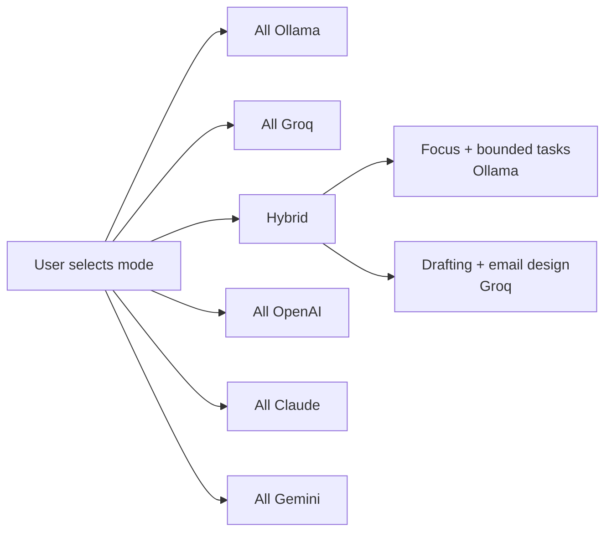

Raw Gmail/Drive context is withheld from cloud model requests by default. In all-Ollama mode it remains on the host. If a user deliberately enables cloud context, the setting is explicit and visible.

The model identifiers are configuration, not hard-coded assumptions. A typical local setup uses Qwen through Ollama, but any replacement model must still satisfy the structured-output and validation contracts.

---

## Dashboard and human workflow

The dashboard is a full operational interface rather than a static visualization.

### Overview

- Select model mode and demo/live research.
- See the seven-day research window.
- Confirm live runs before external services or cloud models are used.
- View connected MCP services and fallback behavior.
- Follow recent editions and their review status.

### Editions

- Search the local archive by title or run ID.
- Filter awaiting-review, approved, failed, needs-packaging, or demo editions.
- Reopen any preserved run.

### MCP connections

- See all nine integrations.
- Enable or disable optional servers.
- Run startup and tool-discovery checks.
- Configure Product Hunt/X fallback preferences.

### Settings

- Configure newsletter identity, audience, topics, time zone, research window, and output workspace.
- Select model route and model identifiers.
- Choose LLM or explicit Jinja Phase 3.
- Connect Google and Product Hunt OAuth in the browser.
- Save non-OAuth service credentials locally.

### Edition review

The review page contains five synchronized tabs:

| Tab | Purpose |
|---|---|
| **Email preview** | Sandboxed desktop/mobile rendering of the generated HTML |
| **Draft** | Editable Markdown source of truth; changes invalidate stale packaging |
| **Research** | Human-readable source cards plus raw per-channel Markdown |
| **Checks** | Actual Phase 3 engine, HTML safety, content preservation, hashes, and report |
| **Activity** | Stage timeline and model request audit |

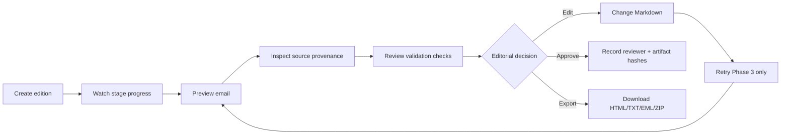

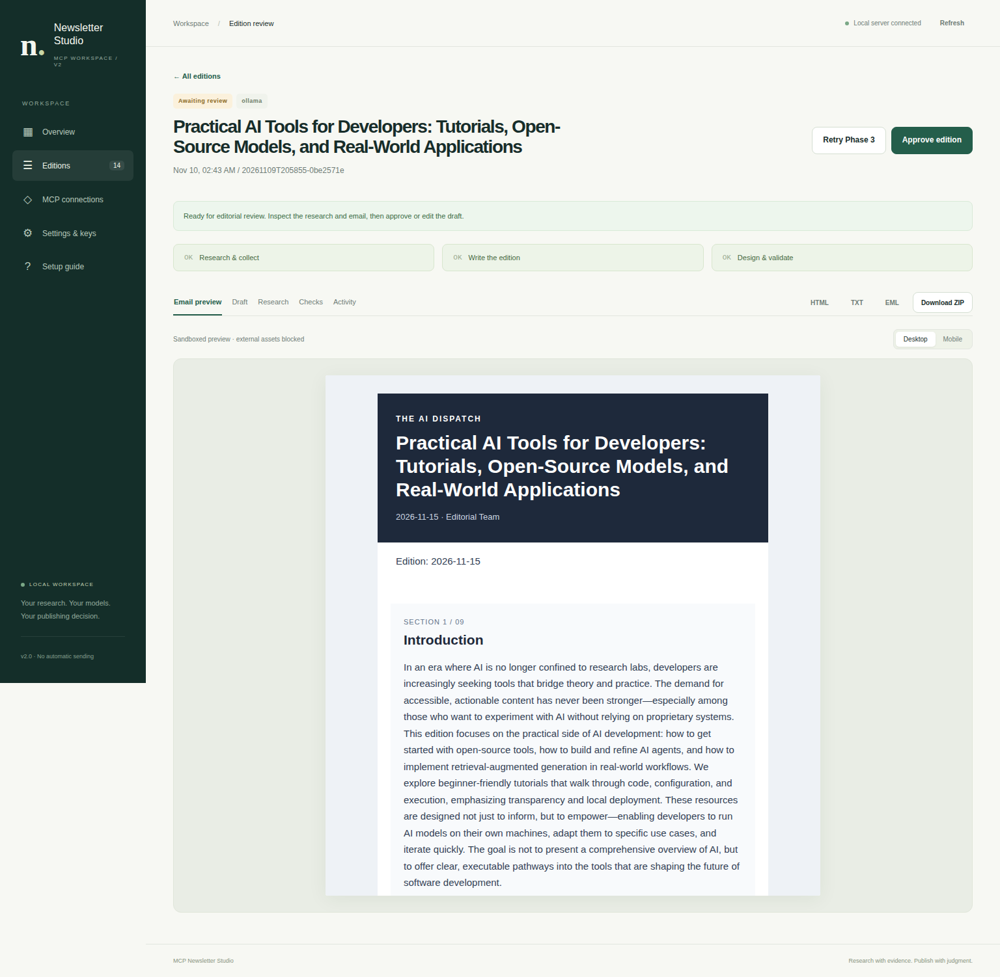


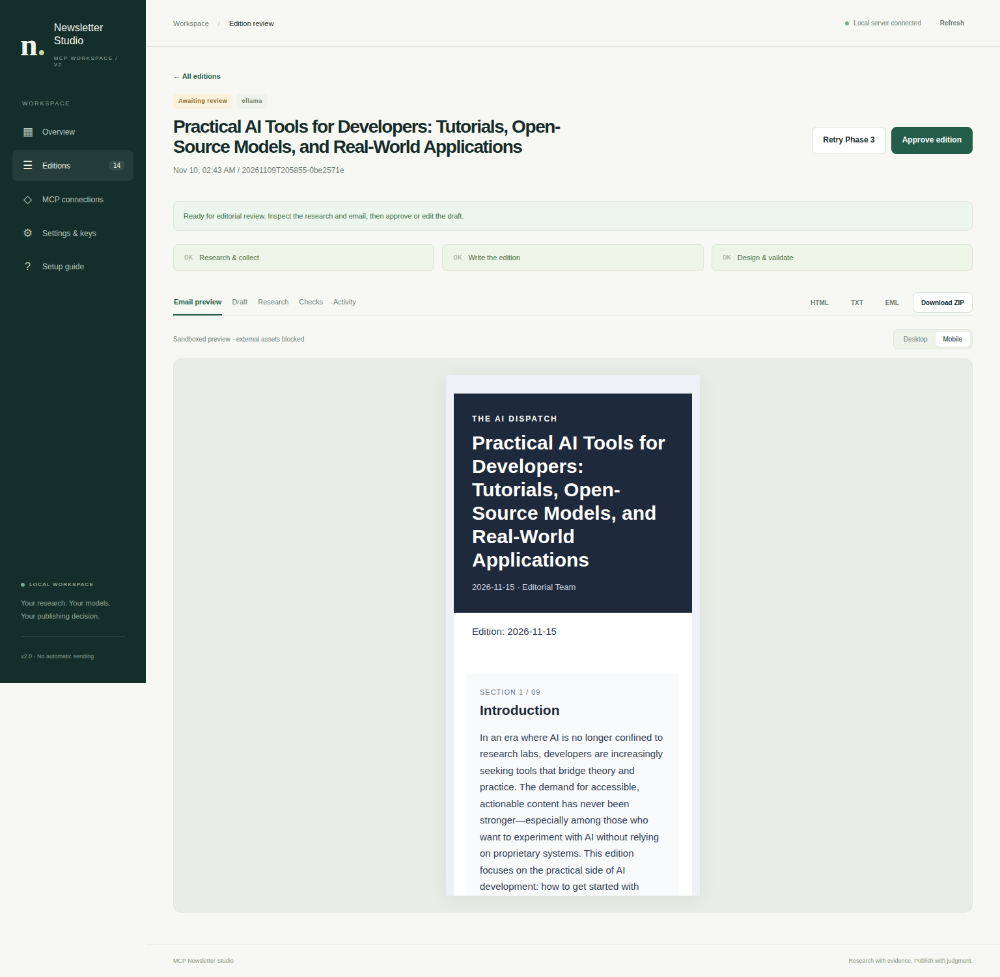

<details>
<summary><strong>More UI screenshots</strong></summary>

### Edition archive

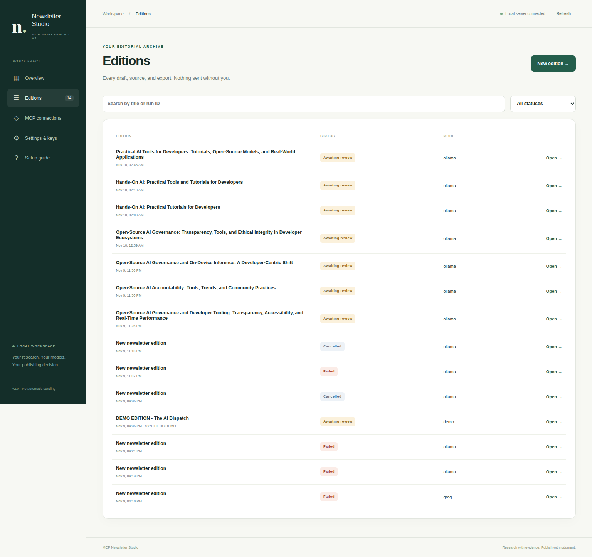

### Quality checks

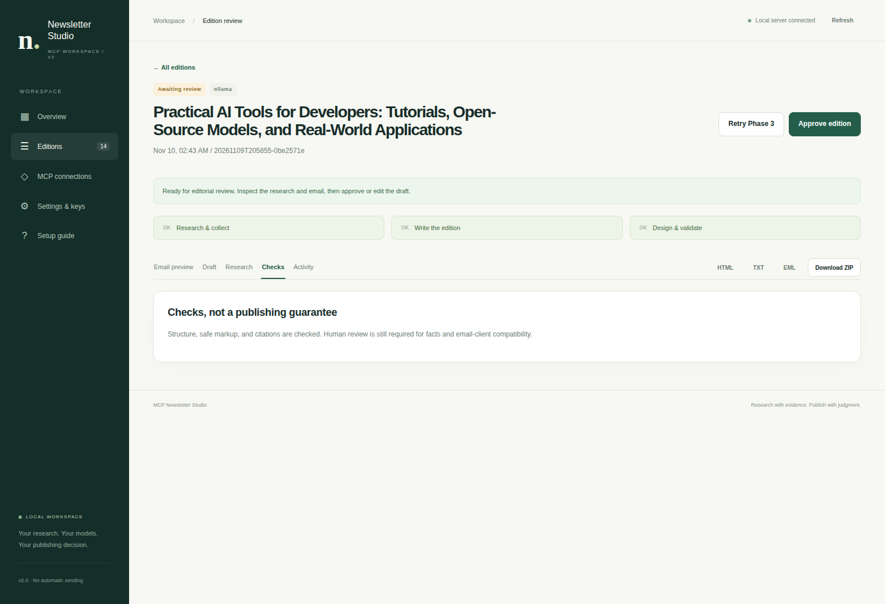

### Activity timeline

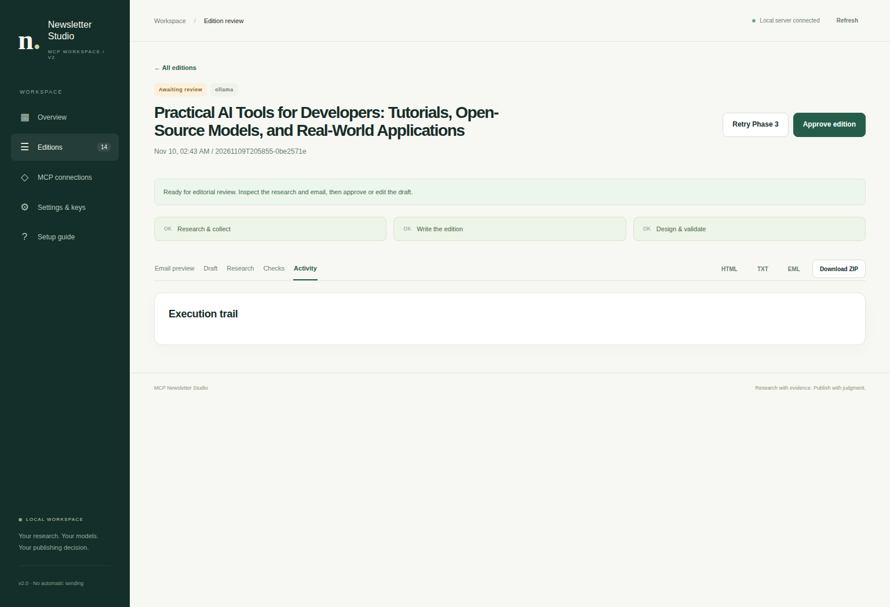

### Responsive dashboard

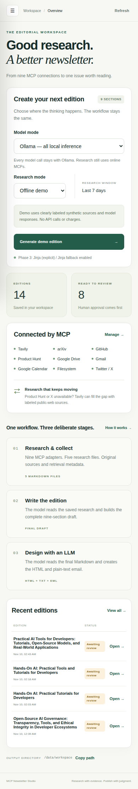

</details>

---

## Artifacts and provenance

Each run gets an identifier such as `20261109T205855-0be2571e` and a dedicated directory:

```text
workspace/
└── issues/
    └── <run-id>/
        ├── web_research.md
        ├── arxiv_research.md
        ├── github_research.md
        ├── product_hunt_research.md
        ├── twitter_research.md
        ├── research.json
        ├── context_summary.json
        ├── focus_plan.json
        ├── draft.json
        ├── final_draft_newsletter.md
        ├── newsletter.html
        ├── newsletter.txt
        ├── newsletter.eml
        ├── phase3_report.json
        ├── quality_report.json
        ├── manifest.json
        └── approval.json
```

### Why so many files?

The artifact set is an audit trail and a recovery mechanism:

- the five research files make each channel readable without opening JSON;
- `research.json` preserves normalized machine-readable provenance;
- `context_summary.json` records which private context was available without exporting its raw contents;
- `focus_plan.json` shows the editorial direction chosen before research was written;
- `draft.json` stores the validated structured draft;
- Markdown is the stable human-editable contract between writing and design;
- HTML, TXT, and EML are the distribution formats;
- reports record how design and validation actually ran;
- the manifest records file hashes, MCP status, warnings, and model audit;
- approval binds a reviewer to exact artifact hashes.

The Filesystem MCP is restricted to the configured workspace. Phase 2 and Phase 3 intentionally re-read their inputs through this server, turning files into real protocol boundaries rather than incidental debug output.

---

## Privacy and security

The project is designed for a single-user local environment and treats private context, model calls, and publication as separate trust decisions.

### Data boundaries

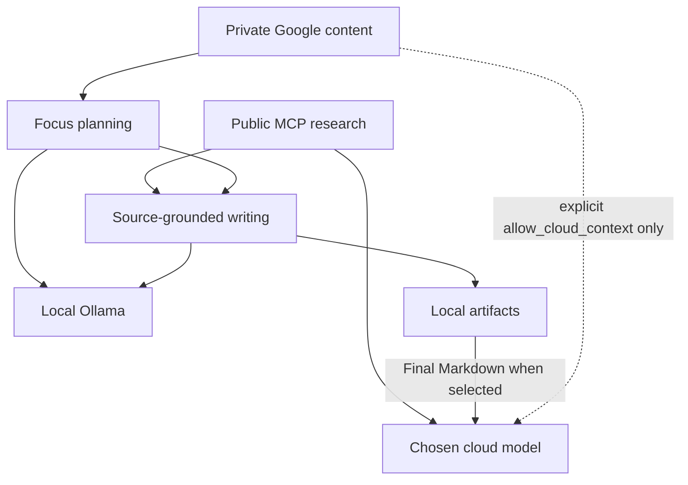

### Implemented controls

- Google OAuth uses only read-only scopes.
- OAuth refresh tokens are stored in a local mode-0600 file.
- Credentials are never displayed back in the dashboard.
- The dashboard can require a bearer token and defaults to localhost.
- Host-header checks reject unexpected hosts.
- The filesystem MCP receives only the configured workspace root.
- Public search queries are built from configured public topics, not raw Gmail text.
- Raw private context is withheld from cloud providers by default.
- Generated email HTML is parsed and checked against a strict allowlist.
- Preview HTML runs inside a sandboxed iframe.
- The application does not send email or automatically publish.
- Approval stores hashes so later edits invalidate the earlier decision.

Never commit `.env`, `secrets/`, OAuth token files, or local state databases. Provider-side spending limits and normal source verification remain part of responsible live operation.

---

## Quick start

### Requirements

- Python 3.11 or newer
- Node.js/npm for the standard Filesystem MCP server
- Ollama for local inference, or credentials for a supported cloud model
- Chromium only when running browser tests
- An internet connection for live MCP research

### Linux / macOS

```bash
git clone <your-repository-url>
cd mcp-newsletter-studio-v2

python3 -m venv .venv
source .venv/bin/activate
python -m pip install -e '.[dev]'

cp .env.example .env
python -m newsletter_mcp serve
```

Open [http://127.0.0.1:8000](http://127.0.0.1:8000).

### Windows PowerShell

```powershell
git clone <your-repository-url>
cd mcp-newsletter-studio-v2

py -3 -m venv .venv
.\.venv\Scripts\python.exe -m pip install -e ".[dev]"
Copy-Item .env.example .env
.\.venv\Scripts\python.exe -m newsletter_mcp serve
```

Using the virtual environment's Python directly avoids changing PowerShell execution policy.

### First run: offline demo

Choose **Offline demo** and click **Generate demo edition**. This exercises all stage transitions, MCP-shaped fixtures, artifact writing, validation, preview, editing, repackaging, downloads, and review without using external APIs or a model download.

CLI equivalent:

```bash
newsletter run --demo
newsletter doctor --demo
newsletter runs
```

### Local Ollama run

```bash
ollama pull qwen3:8b
ollama serve
```

In `.env`:

```dotenv
LLM_PROVIDER=ollama
OLLAMA_BASE_URL=http://127.0.0.1:11434
OLLAMA_MODEL=qwen3:8b
TAVILY_API_KEY=your_tavily_key
DASHBOARD_TOKEN=choose_a_long_random_local_token
```

Start the Studio, connect any optional services, select **Ollama — all local inference**, choose **Live research**, and confirm the run.

### Cloud model run

Select one provider and add its credential to `.env` or through **Settings & keys**:

```dotenv
LLM_PROVIDER=groq
GROQ_API_KEY=your_key

# Alternatives:
# OPENAI_API_KEY=your_key
# ANTHROPIC_API_KEY=your_key
# GEMINI_API_KEY=your_key
```

Groq, OpenAI, Claude, and Gemini are standard supported routes. The selected account must have access to the configured model name.

---

## Google OAuth setup

The custom local Google MCPs use a standard Google Cloud OAuth application.

1. Open the [Google Cloud Console](https://console.cloud.google.com/).
2. Create or select a project.
3. Enable the **Google Drive API**, **Gmail API**, and **Google Calendar API**.
4. Configure the OAuth consent screen.
5. While the app is in testing, add the Google account that owns the newsletter documents as a test user.
6. Create OAuth credentials of type **Desktop app**.
7. Download the JSON and save it as `secrets/client_secret.json`.
8. Start the dashboard.
9. Open **Settings & keys → OAuth connections**.
10. Click **Connect Google Workspace** and grant the four read-only scopes.

A web-application client can also be used when it includes this exact redirect URI:

```text
http://127.0.0.1:8000/api/oauth/callback/google
```

After connection, the UI reports that the local Drive, Gmail, and Calendar MCPs share a refreshable read-only authorization. Reconnecting replaces the local token; disconnecting removes it.

---

## Live MCP setup

Minimal `.env` example:

```dotenv
TAVILY_API_KEY=your_tavily_key
GITHUB_TOKEN=your_github_token
X_BEARER_TOKEN=your_x_app_bearer_token
DASHBOARD_TOKEN=choose_a_long_random_local_token
```

### Tavily

Create a Tavily credential and save it in Settings or as `TAVILY_API_KEY`. Tavily is the required default web-research service and also powers the optional Product Hunt/X public fallback. The configured endpoint is the official remote MCP at `https://mcp.tavily.com/mcp/`.

### GitHub

Create a GitHub personal access token suitable for public repository search and save it as `GITHUB_TOKEN`. The application connects to GitHub's hosted MCP endpoint and calls `search_repositories`. Public unauthenticated behavior can be rate-limited, so a token is recommended.

### Product Hunt

No API key is copied into `.env`. Open **Settings & keys**, click **Connect Product Hunt**, and approve the official Product Hunt OAuth flow. The token is kept in the local MCP OAuth store.

### X

Create an X developer app, copy its app-only Bearer token, and save it as `X_BEARER_TOKEN`. The project uses the official hosted `https://api.x.com/mcp` endpoint in read-only app context. X access and usage terms are controlled by X.

### arXiv

No credential is required. The configured community MCP server searches the public arXiv corpus and remains subject to public service limits.

### Connection doctor

```bash
newsletter doctor
```

The dashboard's **Check connections** action verifies configuration, MCP startup, initialization, and tool discovery. A live run remains the end-to-end authorization test because some providers do not validate every permission until a tool is invoked.

---

## Docker deployment

Docker packages the application, Python environment, Node-based Filesystem MCP dependency, configuration migration, dashboard, and persistent state into a reproducible runtime. The Studio runs as an unprivileged user, stores operational settings in a named volume, and mounts the newsletter output directory separately.

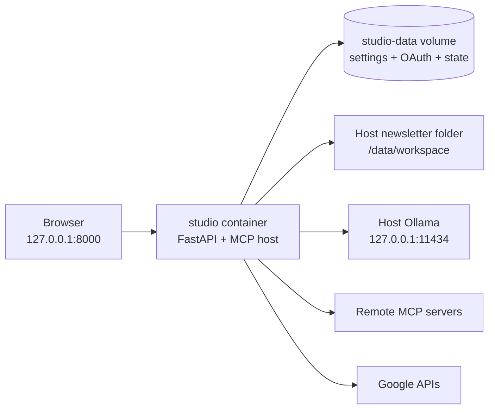

Before starting, edit the host side of the workspace mount in `compose.yaml`:

```yaml
volumes:
  - /absolute/path/to/your/Documents/newsletter:/data/workspace
```

Set a dashboard token in `.env`, then build and start:

```bash
docker compose up -d --build --force-recreate studio
docker compose ps
docker compose logs -f studio
```

When Ollama runs on the host and the Studio uses host networking:

```dotenv
DOCKER_OLLAMA_BASE_URL=http://127.0.0.1:11434
```

An optional Compose profile is included for a containerized Ollama service:

```bash
docker compose --profile local-model up -d
```

The containerized application uses:

- `/data/settings.yaml` for persisted non-secret dashboard settings;
- `/data/secrets/.env` for locally entered secrets;
- `/data/secrets/mcp_oauth.json` for OAuth state;
- `/data/workspace` for edition artifacts;
- `/run/secrets/google_client.json` for the read-only mounted Google client definition.

See [docs/DOCKER.md](docs/DOCKER.md) for operational detail.

---

## CLI and scheduling

The browser is optional; the same pipeline is exposed through the CLI.

```bash
# Run an edition
newsletter run --provider ollama
newsletter run --provider groq
newsletter run --provider hybrid
newsletter run --provider openai
newsletter run --provider claude
newsletter run --provider gemini

# Inspect services and runs
newsletter doctor
newsletter runs

# Re-run Phase 3 from saved Markdown
newsletter render <run-id>

# Start the dashboard
newsletter serve

# Keep a weekly foreground scheduler running
newsletter schedule
```

The scheduler generates drafts; it does not approve or send them. A workspace lock prevents simultaneous mutations, and missed slots are not replayed automatically.

---

## Using the MCP servers with Claude Desktop, Goose, and other hosts

The Studio is a self-contained MCP host, but the servers it uses are standards-based rather than locked to this UI. Remote vendor servers can be registered directly in any compatible host, and the local Google MCP commands can also be launched by another stdio-capable client.

For example, the project-built Drive server command is:

```json
{
  "mcpServers": {
    "newsletter-google-drive": {
      "command": "python",
      "args": ["-m", "newsletter_mcp.google_mcp", "google_drive"],
      "env": {
        "GOOGLE_ACCESS_TOKEN": "SHORT_LIVED_ACCESS_TOKEN"
      }
    }
  }
}
```

Equivalent commands exist for `gmail` and `google_calendar`. In the Studio, token refresh and subprocess injection are handled automatically; a different host must provide its own token-refresh mechanism.

The official Product Hunt, Tavily, GitHub, and X servers publish remote MCP connection instructions that can be used in Claude Desktop, Claude Code, Goose, Codex, Cursor, VS Code, and other compatible clients. This means the project's research layer can be explored interactively outside the scheduled newsletter workflow, while the Studio remains the specialized orchestration product that turns those tools into a repeatable publication pipeline.

MCP itself is an open protocol for connecting models to tools and context; see [Anthropic's MCP overview](https://docs.anthropic.com/en/docs/mcp) and the [Model Context Protocol specification](https://modelcontextprotocol.io/).

---

## Verification and tests

The repository includes unit, integration, API, MCP-contract, validation, and browser-driven tests.

```bash
python -m pip install -e '.[dev]'
python -m pytest -q
```

Latest verified local result:

```text
140 passed, 6 skipped, 1 warning
```

Browser end-to-end tests start a real FastAPI server and use Playwright against the actual UI:

```bash
python -m playwright install chromium
RUN_UI_TESTS=1 python -m pytest tests/e2e -q
```

The browser suite covers:

- all dashboard routes and responsive navigation;
- settings persistence and model selection;
- all nine integration cards;
- demo generation through the asynchronous API;
- live-run confirmation and cancellation;
- research-channel switching;
- Markdown editing and stale-output invalidation;
- Phase 3 retry;
- desktop and mobile email preview;
- HTML/TXT/EML/ZIP downloads;
- approval controls and error presentation.

The portfolio media in this README was captured from the running Docker application. The documented live edition completed with Qwen through Ollama, created the new two-call Learning Corner, preserved source references, and produced the research, Markdown, HTML, TXT, and EML artifacts visible above.

See [docs/TEST_REPORT.md](docs/TEST_REPORT.md), [docs/ARCHITECTURE.md](docs/ARCHITECTURE.md), [docs/SECURITY.md](docs/SECURITY.md), and [docs/TROUBLESHOOTING.md](docs/TROUBLESHOOTING.md).

---

## Project structure

```text
mcp-newsletter-studio-v2/
├── src/newsletter_mcp/
│   ├── cli.py                 # CLI commands and scheduler entry points
│   ├── config.py              # Typed configuration and precedence
│   ├── pipeline.py            # Three-stage orchestration and run lifecycle
│   ├── protocol.py            # MCP transports, initialization, and calls
│   ├── registry.py            # MCP server registry and normalized adapters
│   ├── google_mcp.py          # Drive, Gmail, Calendar local MCP servers
│   ├── llm.py                 # Ollama/Groq/OpenAI/Claude/Gemini adapters
│   ├── staged_draft.py        # Bounded editorial and Learning Corner calls
│   ├── models.py              # Pydantic contracts and reference validation
│   ├── render.py              # Markdown and trusted source rendering
│   ├── email_builder.py       # Fragmented Phase 3, Jinja mode, EML packaging
│   ├── state.py               # Persistent runs, events, and observations
│   ├── webapp.py              # FastAPI routes, auth, OAuth, downloads
│   ├── prompts/               # Versioned prompt assets
│   ├── templates/             # Dashboard and deterministic email templates
│   └── static/                # Dashboard JavaScript and CSS
├── tests/
│   ├── e2e/                   # Playwright browser workflows
│   └── test_*.py              # Unit/integration/API/security tests
├── docs/
│   ├── assets/screenshots/    # Portfolio UI and newsletter captures
│   ├── assets/video/          # Real live-run GIF and MP4 product tour
│   ├── ARCHITECTURE.md
│   ├── SECURITY.md
│   ├── DOCKER.md
│   └── TEST_REPORT.md
├── examples/                  # Demo outputs and host configuration
├── config.yaml                # Distributed non-secret defaults
├── config.local.yaml          # Local dashboard overrides (not for sharing)
├── compose.yaml
├── Dockerfile
└── pyproject.toml
```

### Configuration precedence

```text
config.yaml
    ↓
environment model overrides and credentials
    ↓
config.local.yaml saved by the dashboard
    ↓
per-run CLI --provider override
```

This keeps distributed defaults version-controlled while allowing the UI and deployment environment to own local choices.

---

## TLDR

- **Problem solved:** replaces the repetitive weekly work of collecting AI news, remembering audience preferences, writing a complete issue, and designing an email.
- **Editorial intelligence:** Google Drive contributes ideas, historical performance, and style; Gmail contributes reader feedback; Calendar contributes publication timing.
- **Live research:** Tavily, arXiv, GitHub, Product Hunt, and X MCPs collect current evidence in parallel, with dated filtering, deduplication, source metadata, and labeled fallbacks.
- **Writing:** the selected LLM produces a source-grounded nine-section newsletter; application code owns citations, source IDs, URLs, ordering, and schema validation.
- **Learning:** two focused calls select and write a one-minute technical Learning Corner from the strongest current public evidence.
- **Design:** LLM Phase 3 converts the saved Markdown into validated responsive HTML, plain text, and EML; explicit Jinja mode is available for constrained local hardware.
- **Model support:** local Ollama, Groq, OpenAI, Claude, Gemini, and a local/cloud hybrid route are supported.
- **Durability:** Filesystem MCP saves every channel report, normalized research, focus plan, draft, final Markdown, publication file, quality report, manifest, and approval record.
- **Human control:** the dashboard exposes sources, draft editing, checks, activity, desktop/mobile previews, downloads, and approval without automatically sending email.

---

## License

Released under the [MIT License](LICENSE).
